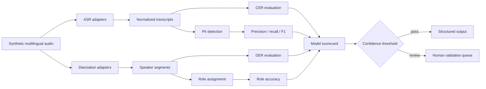

# Multilingual Speech AI Evaluation

A public, sanitized reconstruction of an enterprise speech-AI proof of concept for multilingual customer-service calls. The project evaluates automatic speech recognition (ASR), speaker diarization, role assignment, and personally identifiable information (PII) detection as one measurable pipeline.

> All code and sample data in this repository were rebuilt for public demonstration. The samples are synthetic and contain no employer data, internal endpoints, credentials, recordings, or proprietary source code.

## What I did

I built a prototype that turned Mandarin and Taiwanese Hokkien calls into structured transcripts. I used text-to-speech to replay the same words with background speech or echo, then measured which transcription errors changed.

I ran **4,047 case-level evaluations** across streaming ASR, batch ASR, Hokkien benchmarking, PII detection, and diarization and speaker-role assignment. Each evaluation counts a case tested with a particular model, method or configuration. The approximately 2,800 inferences in the earlier write-up covered the first four workstreams. A single recording can contribute to several evaluations.

## Reported PoC results

| Component | Best aggregate result |
| --- | ---: |
| Mandarin ASR | 6.54% character error rate (CER) |
| Taiwanese Hokkien ASR | 21.78% CER |
| PII detection | 94.8% recall vs. 46.7% for an open-source baseline |
| Speaker diarization | 5.95% diarization error rate (DER) |
| Agent/customer role assignment | 94.6% accuracy across 37 two-person scenarios |

Each row reports the result for its own component and evaluation set. The controlled tests included synthetic speech. Performance on live calls would need separate validation using representative, consented recordings. The public examples below demonstrate how the metrics are calculated.

## Evaluation flow



## Repository contents

- `src/speech_eval/metrics.py` — dependency-free implementations of CER, PII metrics, DER, and role accuracy.
- `scripts/evaluate.py` — evaluates the included synthetic JSONL sample and prints a scorecard.
- `examples/synthetic_predictions.jsonl` — clearly synthetic multilingual examples.
- `tests/` — unit tests for core metric behavior.

## Quick start

```bash
python -m pip install -e .
python scripts/evaluate.py examples/synthetic_predictions.jsonl
python -m unittest discover -s tests
```

## Design principles

- Evaluate the full workflow, not ASR alone.
- Report language-specific performance instead of hiding minority-language errors in a single average.
- Optimize recall for high-risk PII detection, then route uncertain cases to human review.
- Keep model providers behind adapters so the benchmark is reproducible when APIs or models change.
- Treat synthetic evaluation as a Go/No-Go screen, not evidence of production readiness.

## Limitations

- The public examples are intentionally small and synthetic.
- The repository demonstrates evaluation logic, not vendor API integrations.
- DER is calculated from supplied miss, false-alarm, confusion, and reference-duration components; it does not perform timestamp alignment itself.
- Results may change materially with accents, code-switching, background noise, domain terminology, and speaker overlap.

## Author

Hao-Hsuan Chen (Danny) — Applied AI / ML, information retrieval, speech AI, and enterprise workflow automation.

## License

MIT. See [LICENSE](LICENSE).
